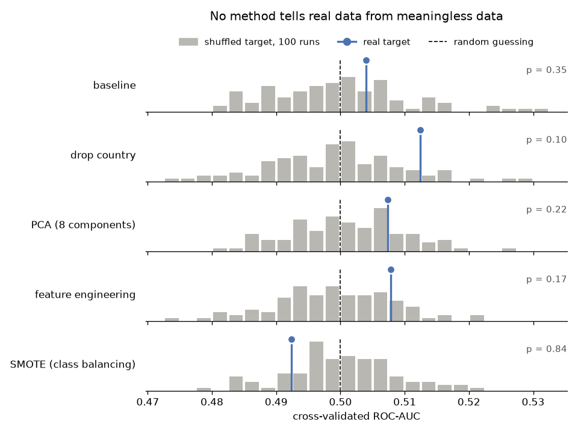
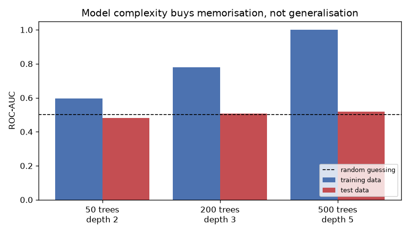

*English · [Русский](README.ru.md)*

# Spotify Churn Analysis

A churn prediction project with a negative result: the features hold no information about
the target. Five control experiments rule out the two other explanations: a pipeline bug and
a weak model.

## Overview

Cross-validated ROC-AUC of gradient boosting is **0.50** with every preprocessing strategy
tried, which is the score of random guessing.

The initial model with tuned hyperparameters reached F1 = 0.193. Five experiments test
whether the model is really at fault: a sanity check of the pipeline on data with known
signal, a comparison of the real labels against deliberately shuffled ones, a breakdown of
what class balancing does to the metrics, a calibration of the mutual information
estimator, and a demonstration of overfitting. All five give the same answer: nothing in
the data supports prediction, so no amount of preprocessing can help.

The project shows how to tell *"the model needs work"* from *"the data has nothing in it"*
before spending effort on the wrong problem.

## Dataset

[Spotify User Behavior for Churn Analysis](https://www.kaggle.com/datasets/nabihazahid/spotify-dataset-for-churn-analysis/data) (Kaggle): 8,000 users, 12 columns.

| Group | Columns |
|---|---|
| Demographics | `gender`, `age`, `country` |
| Subscription | `subscription_type` |
| Listening behaviour | `listening_time`, `songs_played_per_day`, `skip_rate`, `ads_listened_per_week`, `offline_listening` |
| Technical | `device_type` |
| Target | `is_churned` (1 = churned, 0 = retained) |

Churn rate is 25.89% (class ratio about 2.9 : 1), a moderate imbalance that models handle
routinely.

## Key concepts

Two terms come up in several experiments, so they are defined once here.

**Model score.** A classifier does not output a ready answer of "churned / retained". Its
`predict_proba` method assigns each user a number between 0 and 1 (an estimate of how likely
churn is). Turning scores into answers requires a threshold: a rule such as "everyone
scoring above 0.5 counts as churned". The threshold value is an arbitrary choice, and every
threshold-based metric depends on it.

**ROC-AUC.** A ranking-quality metric that does not depend on the threshold. It equals the
fraction of (churned, retained) pairs in which the churned user received the higher score. A
value of 1.0 means every churner ranks above every retained user; a value of 0.5 means the
ordering of scores is random and the model is no better than a coin flip. Because it ignores
the threshold, ROC-AUC shows whether the model separates the classes at all, so it is the
main diagnostic metric here.

## Method

Each experiment answers one question, and later experiments build on earlier ones.
Experiments 1 and 2 evaluate the model with stratified 5-fold cross-validation, experiments
3 and 5 with a 70/30 train/test split. Experiment 4 needs no model: mutual information is
computed on the full data.

### 1. Is the pipeline working?

Before concluding that the data is empty, a bug in the code has to be ruled out: broken
cross-validation or a miscomputed metric would also produce 0.50 on any data. From the
outside the two situations look identical, so the pipeline is tested separately, on data
where signal is known to exist.

A copy of the data gets an artificial column equal to `target + random noise`, which is
related to the target by construction. The gap between the classes in this column is always
exactly 1.0 (churners get +1, retained users +0), and the spread of the noise is set by
hand. The ratio of gap to spread is the signal strength: at a spread of 0.8 the classes are
nearly separated, at 6.0 they are almost fully mixed. Training and evaluation run through
the same code as in every other experiment.

| Injected signal strength (noise spread) | ROC-AUC |
|---|---|
| very weak (6.0) | 0.5155 |
| weak (3.0) | 0.5750 |
| moderate (1.5) | 0.6569 |
| strong (0.8) | 0.8097 |

The metric rises monotonically with signal strength and reacts even to the very weak case,
where the noise is six times the gap between classes. So the pipeline works, and the null
results in the following experiments describe the data.

### 2. Real target vs shuffled target

This experiment checks whether any of the planned improvements (dropping `country`, PCA,
feature engineering, class balancing) extracts anything from the data at all.

Shuffling `is_churned` across rows destroys any relationship by construction: each label
lands on a random user. A single shuffle gives a single random number, so the target is
shuffled 100 times and every method is refitted on each version. The result is the
distribution of ROC-AUC under zero signal, and the score on the real labels is compared
against it. The p-value is the share of shuffles that score at least as high as the real
labels.

| Method | ROC-AUC (real target) | Shuffled target, mean | Shuffled target, 5–95% | p-value |
|---|---|---|---|---|
| baseline | 0.5040 | 0.4997 | 0.4839–0.5164 | 0.35 |
| drop `country` | 0.5125 | 0.4992 | 0.4824–0.5167 | 0.10 |
| PCA (8 components) | 0.5074 | 0.5009 | 0.4869–0.5153 | 0.22 |
| feature engineering (+7 features) | 0.5078 | 0.4990 | 0.4832–0.5122 | 0.17 |
| SMOTE (class balancing) | 0.4924 | 0.5001 | 0.4847–0.5147 | 0.84 |



No method leaves its own distribution: the data behaves exactly like data with shuffled
labels. The smallest p-value, 0.10, belongs to the variant without `country`. It is the best
of five variants, and with a Bonferroni correction for five comparisons the 0.05
significance threshold drops to 0.01. Dropping `country` raised ROC-AUC by 0.009, while the
5–95% interval on the shuffled target is 0.034 wide: the gain is a quarter of the spread
that appears with no signal at all. Picking the best of several such variants is how a
project talks itself into a result that is not there.

### 3. What class balancing actually does

The initial model with tuned hyperparameters scored F1 = 0.193, and the improvement plan
proposed raising it through class balancing. In experiment 2 SMOTE did not raise ROC-AUC,
but ROC-AUC does not depend on the threshold, while F1 does. This experiment uses gradient
boosting with default settings and checks whether balancing improves the model or merely
trades one metric for another.

Three threshold-based metrics are needed here. Precision is the fraction of true churners
among the users the model flagged as churning. Recall is the fraction of all actual churners
that the model caught. F1 is their harmonic mean, which combines both into one number. All
three depend on the threshold: changing the cut-off rule changes them without any change to
the model.

The same model is evaluated five ways: as is (threshold 0.5), after SMOTE balancing, at
thresholds 0.30 and 0.20, and next to a constant "everyone churns" predictor. That predictor
is the floor any useful model must beat. ROC-AUC is reported in every row as the control: if
the model really improved, it would rise; if only the threshold moved, it would stay put.

| Variant | AUC | Precision | Recall | F1 |
|---|---|---|---|---|
| no balancing | 0.5056 | 0.5000 | 0.0032 | 0.0064 |
| SMOTE | 0.4964 | 0.1864 | 0.0177 | 0.0324 |
| threshold 0.30 | 0.5056 | 0.2585 | 0.1948 | 0.2222 |
| threshold 0.20 | 0.5056 | 0.2625 | 0.9130 | 0.4078 |
| always predict churn | 0.5000 | 0.2587 | 1.0000 | 0.4111 |


Lowering the threshold alone pushes F1 from 0.006 to 0.408. That looks like a big
improvement, yet the constant predictor in the last row scores 0.411 and still wins. AUC
stays at about 0.50 in every row, so the model itself never improved.

Precision never leaves 0.26, which is exactly the dataset's churn rate (its base rate). A
model that cannot separate the classes returns a group with churners in the same proportion
as the whole population; picking the same number of users at random would score the same. A
working model selects a group enriched with churners, with precision clearly above the base
rate.

In the first row, precision of 0.50 sounds respectable until recall is placed beside it: the
model flagged seven users out of 2,400 and happened to be right about three. Precision and
recall have to be read together.

### 4. Feature engineering and the noise floor

Feature engineering means building new columns out of existing ones, such as
`songs_per_minute = songs_played_per_day / listening_time`. The question is whether such a
column can hold information about churn that the originals did not. In experiment 2 the
derived features did not raise ROC-AUC, but that result depends on the model: gradient
boosting may simply have failed to use them. Here the information in the features is
measured without a model.

In theory it cannot. A derived feature is computed from the originals, so anyone holding the
originals can produce it, and it tells them nothing new. Formally this is the data
processing inequality, `I(f(X); Y) ≤ I(X; Y)`. In practice feature engineering does help: it
presents information a model already had in a form the model can use. It cannot create
information. The experiment checks whether the dataset is consistent with that expectation.

The measure is mutual information (MI), which shows how much knowing a feature reduces
uncertainty about the target. Zero means full independence: the feature value does not shift
the estimate of churn probability at all; larger values mean a stronger relationship.

The derived features are built in five ways typical for churn problems: an intensity ratio
`songs_per_minute`, an interaction `skip_x_songs`, an engagement measure `engagement`, and
the nonlinear transforms `time_squared` and `log_songs`. Their formulas use exactly three
columns: `listening_time`, `songs_played_per_day` and `skip_rate`. The inequality compares
`f(X)` with the same `X` from which `f` was computed, so only these three columns, out of
the dataset's ten features, count as the original side. Adding `age` or `country`, which
appear in none of the formulas, would compare the derived features against information they
were never built from.

```
Total MI, 3 original features:  0.00000
Total MI, 5 derived features:   0.01544
```

The derived set scores higher than the originals. That alone does not break the theorem:
the inequality bounds the joint information of a feature set, while the script adds up MI
estimates computed for each feature separately.

Before that gap can mean anything, the method has to be able to resolve differences that
small. That calls for data whose correct answer is known in advance, built with the same
technique as in experiment 2: shuffling the target. After shuffling, the true MI is exactly
zero, and anything the estimator reports above zero is pure error. The measurement is taken
on the same five derived features: each feature contributes its own estimation error, and a
sum over five is noisier than a sum over three, so the configuration that produced the
suspicious number is the one to calibrate. There are eight runs because a single value shows
no spread; the exact number does not matter, and five or fifteen would give the same
picture.

```
8 runs: [0.00733 0.00054 0.00136 0.00921 0.02183 0.00890 0.00660 0.01458]
mean 0.00879, max 0.02183
```

On data guaranteed to hold no information the estimator still returns values as high as
0.022: it works from a finite sample and reads coincidence as relationship. The observed
0.01544 sits inside that range, so no measurement can separate it from zero. The derived
features added nothing, and the gap between 0.00000 and 0.01544 is entirely the method's own
imprecision.

A small positive MI value proves nothing until it is compared with the noise of the
estimator itself.

### 5. The model learns noise

Null metrics might suggest that no learning happens. The model does learn, and this
experiment shows what it learns and why only a test set reveals it.

Models of increasing capacity are fitted on 70% of the data, then each is scored twice: on
the same 70% it has seen (the training set), and on the remaining 30% it has not (the test
set).

| Trees | Depth | AUC (train) | AUC (test) |
|---|---|---|---|
| 50 | 2 | 0.5956 | 0.4810 |
| 200 | 3 | 0.7793 | 0.5059 |
| 500 | 5 | 0.9995 | 0.5190 |



At 500 trees the model separates the training set almost perfectly: it has enough capacity
to memorise individual rows. Rules of the form *"the user with age 34, listening_time 187
and skip_rate 0.22 churned"* are exactly true for one row and useless for every other one,
because no pattern stands behind them. On the test set the score stays at coin-flip
level.

The weakest configuration is the informative one: 50 trees at depth 2 cannot memorise, so
their training score of 0.5956 reflects the absence of structure. The more capacity a model
has, the higher its training AUC climbs on data with no signal, and the more the test set
matters. Scored on training data alone, this dataset would look like a complete success.

## Conclusion

Five results point the same way:

- ROC-AUC of 0.50 for gradient boosting with every preprocessing strategy
- ROC-AUC on real labels inside the distribution from 100 shuffles (p-values from 0.10 to
  0.84)
- mutual information indistinguishable from the estimator's own noise floor
- precision pinned to the base rate regardless of balancing
- a model with a tuned threshold that loses to a constant predictor by 0.003 F1

The features do not carry information about the target. The numeric columns are uniformly
distributed, which suggests the dataset is synthetic, with labels assigned independently of
user behaviour.

Practical takeaway: before any tuning, run a simple model and check a threshold-independent
metric. ROC-AUC near 0.50 means the ceiling has already been reached, and further
hyperparameter search will only fit validation noise.

## Repository structure

```
├── data/
│   └── spotify_churn_dataset.csv
├── reports/
│   └── figures/                 generated by the script
├── src/
│   └── experiments.py           all five experiments
├── requirements.txt
└── README.md
```

## Running

```bash
python -m venv .venv
source .venv/bin/activate          # Windows: .venv\Scripts\activate
pip install -r requirements.txt
python src/experiments.py
```

Runtime is about 14 minutes on four cores. Nearly all of it goes to the permutation test in
experiment 2; the number of shuffles is set by the `N_PERMUTATIONS` constant. All result
tables are printed to stdout, and the figures are written to `reports/figures/`.

## Notes and limitations

- The numbers were obtained on Python 3.13 with pandas 3.0.5, scikit-learn 1.9.0 and
  matplotlib 3.11.1. The PCA and SMOTE rows of experiment 2 depend on the environment in the
  third or fourth decimal: on Python 3.14 the real ROC-AUC for PCA came out as 0.5055.
- The absence of signal is shown empirically; there is no formal proof. A relationship of a
  very different shape could exist and escape gradient boosting, although the mutual
  information results make that unlikely.
- A next step would be to apply the same diagnostics to a dataset that does contain signal
  and compare the two outcomes side by side.

## License

MIT. See [LICENSE](LICENSE).
