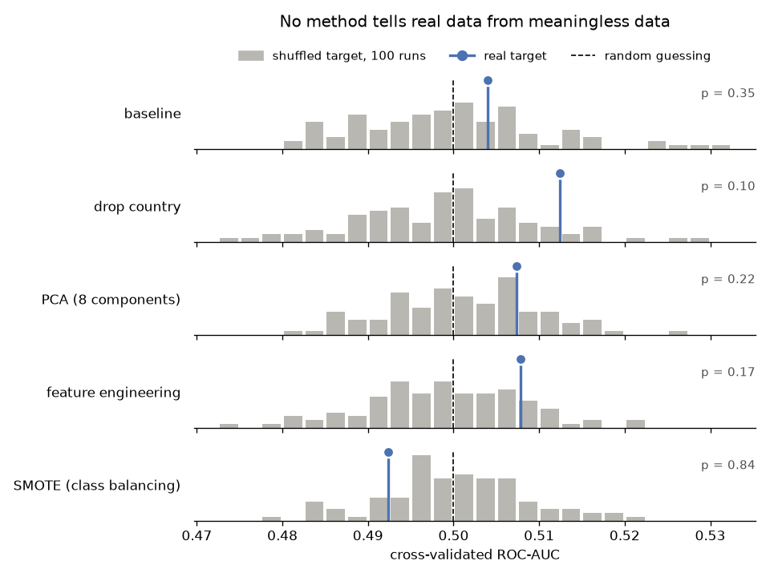
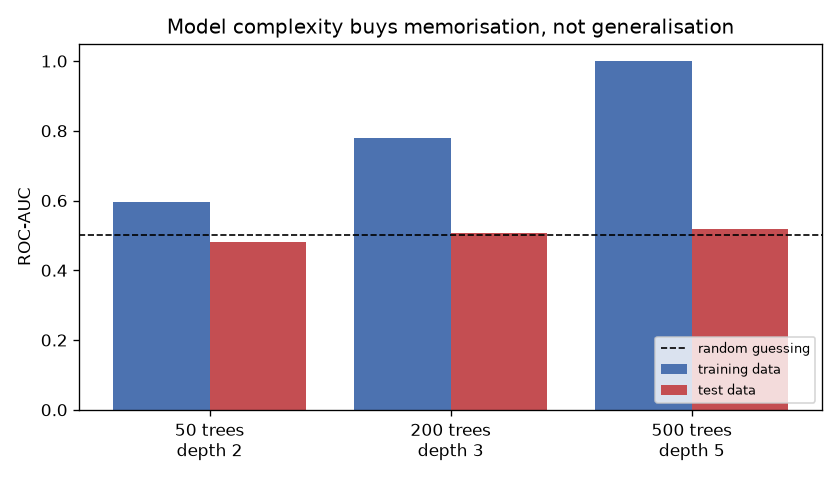

*[English](README.md) · Русский*

# Spotify Churn Analysis

Проект по предсказанию оттока с отрицательным результатом: признаки не несут информации о
целевой переменной. Пять контрольных экспериментов исключают две другие причины: ошибку в
пайплайне и слабую модель.

## О проекте

Кросс-валидированный ROC-AUC градиентного бустинга держится на уровне **0.50** при всех
способах предобработки, а это результат случайного угадывания.

Исходная модель с подобранными гиперпараметрами дала F1 = 0.193. Пять экспериментов
выясняют, действительно ли дело в модели: контрольная проверка пайплайна на данных с
заведомым сигналом, сравнение реальной разметки с намеренно перемешанной, разбор влияния
балансировки классов на метрики, калибровка оценщика взаимной информации и демонстрация
переобучения. Все пять сходятся к одному: в данных нет ничего, на чём можно строить
предсказание, поэтому никакая предобработка не поможет.

Проект показывает, как отличить ситуацию *«модель нужно доработать»* от ситуации *«в данных
ничего нет»* до того, как силы уйдут не на ту задачу.

## Данные

[Spotify User Behavior for Churn Analysis](https://www.kaggle.com/datasets/nabihazahid/spotify-dataset-for-churn-analysis/data) (Kaggle): 8 000 пользователей, 12 колонок.

| Группа | Колонки |
|---|---|
| Демография | `gender`, `age`, `country` |
| Подписка | `subscription_type` |
| Поведение при прослушивании | `listening_time`, `songs_played_per_day`, `skip_rate`, `ads_listened_per_week`, `offline_listening` |
| Технические данные | `device_type` |
| Целевая переменная | `is_churned` (1 = ушёл, 0 = остался) |

Доля оттока 25.89%, соотношение классов примерно 2.9 : 1. Это умеренный дисбаланс, с которым
модели справляются штатно.

## Ключевые понятия

Два термина используются в нескольких экспериментах, поэтому вводятся один раз здесь.

**Балл модели.** Классификатор не выдаёт готовый ответ «ушёл / остался». Метод
`predict_proba` возвращает каждому пользователю число от 0 до 1 (оценку вероятности оттока).
Чтобы превратить баллы в ответы, нужен порог: правило вида «все, у кого балл выше 0.5,
считаются ушедшими». Значение порога выбирается произвольно, и от него зависят все пороговые
метрики.

**ROC-AUC.** Метрика качества ранжирования, не зависящая от порога. ROC-AUC равен доле пар
«ушедший + оставшийся», в которых ушедший получил от модели балл выше. Значение 1.0
означает, что всякий ушедший стоит выше всякого оставшегося; значение 0.5 означает, что
порядок баллов случаен и модель не лучше подбрасывания монеты. Поскольку порог на ROC-AUC не
влияет, он показывает, различает ли модель классы в принципе. Это основная метрика
диагностики.

## Методика

Каждый эксперимент отвечает на один вопрос, и следующие опираются на предыдущие. В
экспериментах 1 и 2 модель оценивается пятикратной стратифицированной кросс-валидацией, в
экспериментах 3 и 5 используется разбиение train/test 70/30. Эксперимент 4 обходится без
модели: взаимная информация считается по всем данным.

### 1. Исправен ли пайплайн?

Прежде чем делать вывод об отсутствии сигнала, нужно исключить ошибку в коде: сломанная
кросс-валидация или неверно посчитанная метрика тоже дадут 0.50 на любых данных. Снаружи эти
две ситуации неотличимы, поэтому пайплайн проверяется отдельно, на данных, где сигнал
заведомо есть.

В копию данных добавляется искусственная колонка `таргет + случайный шум`, по построению
связанная с таргетом. Разрыв между классами в этой колонке всегда равен 1.0 (ушедшим
прибавляется единица, оставшимся ноль), а разброс шума задаётся вручную. Отношение разрыва к
разбросу и есть сила сигнала: при разбросе 0.8 классы почти разделены, а при 6.0 почти
полностью перемешаны. Обучение и оценка идут тем же кодом, что и во всех остальных
экспериментах.

| Сила искусственного сигнала (разброс шума) | ROC-AUC |
|---|---|
| очень слабый (6.0) | 0.5155 |
| слабый (3.0) | 0.5750 |
| умеренный (1.5) | 0.6569 |
| сильный (0.8) | 0.8097 |

Метрика растёт монотонно с силой сигнала и реагирует даже на очень слабый сигнал, где шум в
шесть раз перекрывает разрыв между классами. Значит, пайплайн исправен, и нулевые результаты
в следующих экспериментах описывают данные.

### 2. Реальный таргет против перемешанного

Эксперимент проверяет, извлекает ли хоть один из запланированных методов улучшения (удаление
`country`, PCA, feature engineering, балансировка) хоть что-то из данных.

Перемешивание `is_churned` между строками уничтожает любую связь по построению: метка
достаётся случайному пользователю. Одно перемешивание даёт одно случайное число, поэтому
таргет перемешивается 100 раз, и каждый метод заново обучается на каждом варианте. Так
получается распределение ROC-AUC при заведомо нулевом сигнале, и с ним сравнивается результат
на настоящей разметке. P-value — доля перемешиваний, на которых ROC-AUC оказался не ниже
реального.

| Метод | ROC-AUC (реальный таргет) | Перемешанный таргет, среднее | Перемешанный таргет, 5–95% | p-value |
|---|---|---|---|---|
| базовая модель | 0.5040 | 0.4997 | 0.4839–0.5164 | 0.35 |
| убрать `country` | 0.5125 | 0.4992 | 0.4824–0.5167 | 0.10 |
| PCA (8 компонент) | 0.5074 | 0.5009 | 0.4869–0.5153 | 0.22 |
| feature engineering (+7 признаков) | 0.5078 | 0.4990 | 0.4832–0.5122 | 0.17 |
| SMOTE (баланс классов) | 0.4924 | 0.5001 | 0.4847–0.5147 | 0.84 |



Ни один метод не выходит за пределы своего распределения: данные ведут себя так же, как
данные с перемешанной разметкой. Наименьшее p-value, 0.10, у варианта без `country`. Это
лучший из пяти вариантов, а с поправкой Бонферрони на пять сравнений порог значимости 0.05
снижается до 0.01. Удаление `country` подняло ROC-AUC на 0.009, а интервал 5–95% на
перемешанном таргете имеет ширину 0.034: прирост вчетверо меньше разброса, который возникает
и без сигнала. Именно так, перебирая варианты и оставляя лучший, проект убеждает себя в
результате, которого нет.

### 3. Что на самом деле делает балансировка классов

Исходная модель с подобранными гиперпараметрами имела F1 = 0.193, и план улучшений
предполагал поднять его балансировкой классов. В эксперименте 2 SMOTE не поднял ROC-AUC, но
ROC-AUC от порога не зависит, а F1 зависит. Здесь используется бустинг с настройками по
умолчанию, и эксперимент проверяет, улучшает ли балансировка модель или только меняет одну
метрику на другую.

Здесь нужны три пороговые метрики. Precision — доля действительно ушедших среди тех, кого
модель пометила как ушедших. Recall — доля пойманных моделью среди всех настоящих ушедших.
F1 — их среднее гармоническое, которое сводит обе величины в одно число. Все три зависят от
порога: изменение правила отсечения меняет их без какого-либо изменения модели.

Одна и та же модель оценивается пятью способами: как есть (порог 0.5), после балансировки
SMOTE, с порогами 0.30 и 0.20, а рядом ставится константный предсказатель «все ушли». Это
нижняя планка, которую обязана превзойти любая полезная модель. ROC-AUC приводится в каждой
строке как контроль: если модель действительно улучшилась, он вырастет; если меняется только
порог, он останется на месте.

| Вариант | AUC | Precision | Recall | F1 |
|---|---|---|---|---|
| без балансировки | 0.5056 | 0.5000 | 0.0032 | 0.0064 |
| SMOTE | 0.4964 | 0.1864 | 0.0177 | 0.0324 |
| порог 0.30 | 0.5056 | 0.2585 | 0.1948 | 0.2222 |
| порог 0.20 | 0.5056 | 0.2625 | 0.9130 | 0.4078 |
| константа «все ушли» | 0.5000 | 0.2587 | 1.0000 | 0.4111 |


Одно только снижение порога поднимает F1 с 0.006 до 0.408. Выглядит как заметный прогресс,
но константа в последней строке даёт 0.411 и всё равно выигрывает. AUC при этом во всех
строках остаётся около 0.50, то есть сама модель не улучшилась ни разу.

Precision не уходит от 0.26, а это в точности доля оттока во всей выборке (её базовая
частота). Если модель не умеет различать классы, любая отобранная ею группа содержит ушедших
в той же пропорции, что и выборка целиком; отбор наугад дал бы тот же результат. Работающая
модель тем и отличается, что её выборка обогащена ушедшими и precision заметно выше базовой
частоты.

В первой строке precision 0.50 звучит прилично, пока рядом не поставлен recall: модель
пометила семь пользователей из 2400 и угадала в трёх случаях. Precision и recall нужно
читать вместе.

### 4. Feature engineering и уровень шума

Feature engineering — создание новых колонок из существующих, например
`songs_per_minute = songs_played_per_day / listening_time`. Вопрос в том, может ли такая
колонка содержать информацию об оттоке, которой не было в исходных. В эксперименте 2
производные признаки не подняли ROC-AUC, но этот результат зависит от модели: возможно,
бустинг просто не сумел ими воспользоваться. Здесь информация в признаках измеряется без
модели.

Теоретически не может. Производный признак вычисляется из исходных, значит, зная исходные,
всегда можно получить производный, и ничего нового он не сообщает. Формально это неравенство
обработки данных: `I(f(X); Y) ≤ I(X; Y)`. На практике feature engineering всё же помогает:
он подаёт уже имеющуюся информацию в форме, удобной конкретной модели. Создать информацию он
не может. Эксперимент проверяет, согласуется ли датасет с этим ожиданием.

В качестве меры используется взаимная информация (mutual information, MI). Она показывает,
насколько знание признака снижает неопределённость таргета. Ноль означает полную
независимость: значение признака не меняет оценку вероятности оттока ни на сколько; чем
больше значение, тем сильнее связь.

Производные признаки построены пятью типичными для churn-задач способами: интенсивность
`songs_per_minute`, взаимодействие `skip_x_songs`, вовлечённость `engagement`, нелинейные
преобразования `time_squared` и `log_songs`. В их формулах участвуют ровно три колонки:
`listening_time`, `songs_played_per_day`, `skip_rate`. Неравенство сравнивает `f(X)` с тем
самым `X`, из которого `f` вычислена, поэтому исходными считаются только эти три колонки из
десяти признаков датасета. Если добавить `age` или `country`, которых нет в формулах,
производные признаки сравнивались бы с информацией, из которой их не строили.

```
Сумма MI, 3 исходных признака:   0.00000
Сумма MI, 5 производных:         0.01544
```

Производные показывают больше исходных. Теорему это само по себе не нарушает: неравенство
ограничивает совместную информацию набора признаков, а скрипт складывает оценки MI,
посчитанные для каждого признака отдельно.

Прежде чем толковать эту разницу, нужно узнать, различает ли метод такие мелкие величины
вообще. Для этого требуются данные, где правильный ответ известен заранее, и строятся они
тем же приёмом, что в эксперименте 2: перемешиванием таргета. После перемешивания истинная
MI равна ровно нулю, и всё, что оценщик выдаст сверх нуля, — чистая погрешность. Замер
делается на тех же пяти производных признаках: каждый признак вносит собственную ошибку,
сумма по пяти шумит сильнее суммы по трём, поэтому калибровать нужно ровно ту конфигурацию,
которая дала подозрительное число. Прогонов восемь: по единственному значению разброс не
увидеть. Само число непринципиально: пять или пятнадцать дали бы ту же картину.

```
8 прогонов: [0.00733 0.00054 0.00136 0.00921 0.02183 0.00890 0.00660 0.01458]
среднее 0.00879, максимум 0.02183
```

На данных, заведомо не содержащих информации, оценщик выдаёт значения вплоть до 0.022: он
считает по конечной выборке и случайные совпадения принимает за связь. Наблюдаемые 0.01544
попадают внутрь этого разброса, то есть отличить их от нуля измерением невозможно.
Производные признаки не добавили информации, а разница между 0.00000 и 0.01544 целиком
объясняется погрешностью метода.

Маленькое положительное значение MI ничего не доказывает, пока его не сравнили с шумом
самого оценщика.

### 5. Модель заучивает шум

Может показаться, что нулевые метрики означают «обучение не происходит». Модель обучается, и
этот эксперимент показывает, что именно она выучивает и почему это видно только на тестовой
выборке.

Модели нарастающей сложности обучаются на 70% данных, после чего каждая оценивается дважды:
на тех же 70%, которые она видела (обучающая выборка), и на остальных 30%, которых не видела
(тестовая выборка).

| Деревьев | Глубина | AUC (train) | AUC (test) |
|---|---|---|---|
| 50 | 2 | 0.5956 | 0.4810 |
| 200 | 3 | 0.7793 | 0.5059 |
| 500 | 5 | 0.9995 | 0.5190 |



На 500 деревьях модель почти идеально разделяет обучающую выборку: ёмкости хватает, чтобы
запомнить отдельные строки. Правила вида *«пользователь с age 34, listening_time 187 и
skip_rate 0.22 ушёл»* верны ровно для одной строки и бесполезны для всех остальных, потому
что за ними не стоит закономерность. На тестовой выборке результат остаётся на уровне
монеты.

Показательна как раз самая слабая конфигурация: 50 деревьев глубины 2 не могут ничего
запомнить, поэтому их результат на обучении, 0.5956, отражает отсутствие структуры. Чем
больше у модели ёмкость, тем выше её AUC на обучении, хотя сигнала в данных нет, и тем
важнее тестовая выборка. Оценка только на обучающих данных представила бы этот датасет как
полный успех.

## Выводы

Пять результатов указывают на одно:

- ROC-AUC 0.50 у градиентного бустинга при всех способах предобработки
- ROC-AUC на настоящей разметке лежит внутри распределения по 100 перемешиваниям (p-value от
  0.10 до 0.84)
- взаимная информация неотличима от собственного шума оценщика
- precision закреплён на уровне базовой частоты независимо от балансировки
- модель с подобранным порогом проигрывает константному предсказателю 0.003 по F1

Признаки не несут информации о целевой переменной. Числовые колонки распределены равномерно.
Это указывает на то, что датасет синтетический, а метки проставлены независимо от поведения
пользователей.

Практический вывод: до начала тюнинга прогнать простую модель и посмотреть на метрику, не
зависящую от порога. ROC-AUC около 0.50 означает, что потолок уже достигнут, и дальнейший
перебор гиперпараметров будет подгонкой под шум валидации.

## Структура репозитория

```
├── data/
│   └── spotify_churn_dataset.csv
├── reports/
│   └── figures/                 создаётся скриптом
├── src/
│   └── experiments.py           все пять экспериментов
├── requirements.txt
└── README.md
```

## Запуск

```bash
python -m venv .venv
source .venv/bin/activate          # Windows: .venv\Scripts\activate
pip install -r requirements.txt
python src/experiments.py
```

Прогон занимает около 14 минут на четырёх ядрах. Почти всё время уходит на перестановочный
тест в эксперименте 2; число перемешиваний задаётся константой `N_PERMUTATIONS`. Все таблицы
с результатами выводятся в консоль, графики сохраняются в `reports/figures/`.

## Оговорки и ограничения

- Числа получены на Python 3.13 с pandas 3.0.5, scikit-learn 1.9.0 и matplotlib 3.11.1.
  Строки PCA и SMOTE в эксперименте 2 зависят от окружения в третьем-четвёртом знаке: на
  Python 3.14 реальный ROC-AUC для PCA получался равным 0.5055.
- Отсутствие сигнала показано эмпирически; строгого доказательства нет. Зависимость
  принципиально иной формы могла бы ускользнуть от градиентного бустинга, хотя результаты по
  взаимной информации делают это маловероятным.
- Следующий шаг: применить ту же диагностику к датасету, где сигнал есть, и сравнить два
  исхода рядом.

## Лицензия

MIT, см. [LICENSE](LICENSE).
